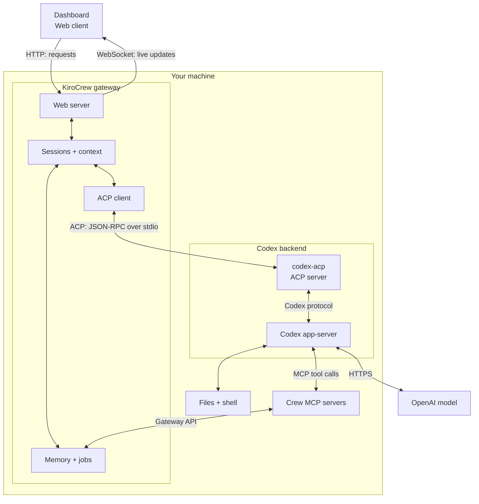
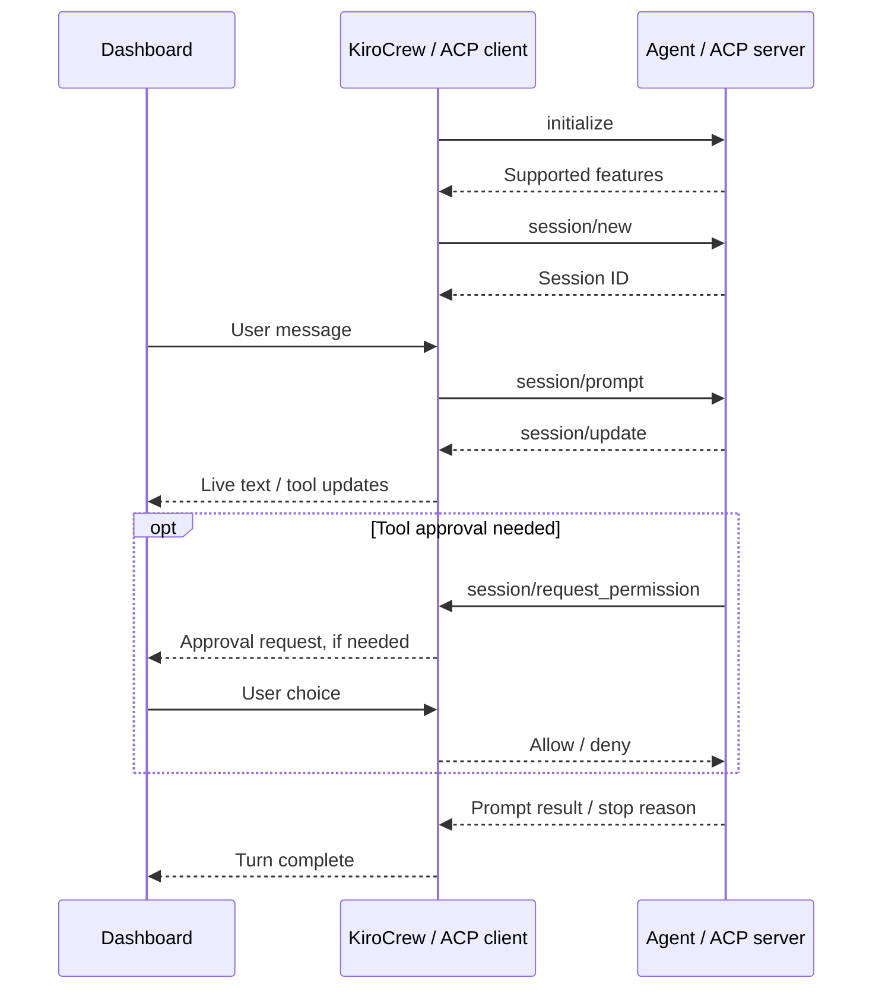

At work, one of the tools we use every day is [kirocrew](https://kiro.dev/docs/crew/). While there are many flavors or agentic harnesses as of writing this, there are several standout features to `kirocrew` that have made it, for one reason or another, the desirable harness at this time to accelerate development using agentic tooling.

## Things we like about kirocrew

Keep in mind, these are just things I like about the harness. That does not mean they are in any way novel or proprietary to the harness. At the end of the day, it's still just a harness.

### Cross Session Memory

I think a lot of us have felt this problem in the last year, and many of us have solved it in different ways. It is absolutely the desired state for our harness and model inference to be able to access and reference categorically similar or temporally related chats in order to perform better at the task at hand, without reproducing the same burden of context. Why was this not innately built into our harnesses like claude or codex? Even kiro-cli (amazon q) had this concept of remote cross session memory using AgentCore Memory which is just a thin AWS web service wrapper around an SQLite db (Which you could fucking set up yourself and not pay AWS). So we did do that, and earlier this year we released [`xscs`](https://npmjs.org/package/cross-session-summary) (_cross session context store_) to solve this problem for my team. It operates very similarly to the AgentCore memory approach, but instead of you feeding your sessions to AWS, you now locally store the key context from sessions in a local database, and use lifecycle hooks across agnostic harness sessions to contribute context or retrieve context from the store. All innate, happens behind the scenes without the user's active influence, with backdoors for a user to remove or specifically add context to the shared store. Have one session in a workspace with claude, have another with codex, have them share access to the same memory per project (git remote). Fits the bill and works fine, but how many teams whipped together a custom solution to what is essentially the same problem? I would wager a lot.

Is that a market saturation issue? No it's more likely representative of the shifting of software's paradigm that open source libraries and established recosystem adoption of software libraries/solutions to problems may not be as important and vital in the new age of software delivery with AI, this is because whereas previously software generation was expensive and time consuming, it is now cheap, rapid, and increasing in generated output quality (to a sane extent). This is a theme explored in Tanner Linsley's [_Projecting React_](https://tannerlinsley.com/posts/projecting-react), where Tanner talks about how he was able to reproduce the core and fiber model of React (for tanstack's purposes) over the course of a weekend (he mentioned nothing about how many mushrooms he consumed during that weekend to do so, but we'll follow up with him and get you an answer).

Anyway, `kirocrew` does cross session memory storage and indexing for you. You don't need `xscs` or whatever bespoke thing your team came up with and now needs to maintain. Kirocrew as a harness is able to load, search, and index other sessions within the harness, allowing for cross session memories to emerge. Often times this recall may not even need to be invoked intentionally by the user, an added benefit. In a short while in this essay, we'll go through how to use kirocrew with whatever subscription you have, or with ollama, so you do not need to add another model subscription to your already overexpended budget.

> We used to know this. We used to have this concept called "NIH" which stood for Not Invented Here syndrome, where this offshoot of software engineer would build out their own, often times, worse version of a public dependency because that dependency was _not invented here_ and so they felt the need to construct it themselves. It's a horrid syndrome, comes with all sorts of weird symptoms, like having to maintain a shit fucking box bespoke solution until you come full ouroboros and adopt the ecosystem saturated dependency. Now with software generation being so cheap, we all seem to have buried NIH down deep and locked it away, and said _forego what you know_. This will prove to be the thematic motif of the age of gpt-* based software development.

### Client Server Model

`kirocrew` ships with a client-server model that has some strong advantages to it over remote development.

#### ACP Backend Flexibility

We're going to talk more about this and the configuration of this later on when we get into a more hands on demonstration of kirocrew setup with an ACP backend, but for now let's just talk top level about some of the benefits of this. For one, you choose your model inference layer. Use `kirocrew` with OpenAI's models, or Anthropic's models, or local running models with llama.cpp or ollama. Whatever inference is your preference, is enabled by the server supporting ACP protocol for ACP backend. For ollama specifically, there are some unique workarounds we can implement to enable `kirocrew` to use ollama as a backend. For example, since [we can use ollama as the model inference backend with either codex or claude cli as the harness layer](https://docs.ollama.com/integrations/claude-code) we can use the existing community claude-acp and codex-acp libraries to enable by proxy inference through ollama, and whatever locally running models we provision through it.

#### Desktop Support Doesn't Matter

Since it essentially exposes a web application through localhost:5476 to serve through a thin desktop client shell, you do not need to wait for desktop support to use kirocrew. You can install the underlying `kirocrew` binary, go through a small amount of setup, and then just hit the web application at <http://localhost:5476> in your browser.

As an added bonus, with tailscale you can create a private tailnet which you can then use to use kirocrew from other devices within the private tailnet, such as an iPhone or an Android or some other laptop/desktop. So you can run kirocrew on your most heavily resourced host and then connect to the GUI via some other laptop or interface.

_I'm including some diagrams on the client server model, and ACP's role in it below._

#### Client Server Model



#### Sequence Flow



### Open Source (For Now)

The product is open source. You can go and [fork the harness here](https://github.com/kirodotdev/kirocrew) and then run the harness and have it tell you how it works. We're so fucking here. It being open source means you can also modify it (It's Apache 2.0). Extend it in whatever way you like. Port it to rust, _groans uncomfortably_.

## Setting up KiroCrew

### **macOS**

Download the **Stable macOS `.dmg`** from [Kiro Crew downloads](https://github.com/kirodotdev/KiroCrew#app-downloads).

Open it and drag Kiro Crew into Applications. Launch the app, follow setup, and sign in.

### **Linux**

Install Kiro CLI and sign in:

```bash
curl -fsSL https://cli.kiro.dev/install | bash
kiro-cli login
```

Install Crew, check setup, and start the server:

```bash
curl -fsSL https://download.crew.kiro.dev/cli.sh | sh
kirocrew setup
kirocrew doctor
kirocrew gateway
```

Open [the dashboard](http://localhost:5476). Keep the terminal open while using Crew.

See the [official install guide](https://github.com/kirodotdev/KiroCrew/blob/main/docs/guides/install.md).

### **Windows**

Download the [Stable Windows installer](https://download.crew.kiro.dev/desktop/stable/latest/KiroCrew-Setup.exe).

Run it and use the default per-user install. Launch Kiro Crew, follow setup, and sign in.

See the [Windows guide](https://github.com/kirodotdev/KiroCrew/blob/main/docs/guides/windows-install.md).

The desktop apps bundle Python and Kiro CLI. No separate Node.js install is needed. See [requirements](https://kiro.dev/docs/crew/installation/).

## Using ACP with KiroCrew

This is the heart of what I hope to enable for you today. If you leave here being able to use KiroCrew as a harness, with ACP enabled claude or codex backends, then I will have done the job I arbitrarily assigned myself.

### What is ACP?

ACP is the Agent Client Protocol, like it's posh cousin MCP, it is essentially inventing almost nothing new over the existing JSON-RPC 2.0 concept, and profiting en masse from it. The docs don't say that however, the docs say,

> The Agent Client Protocol (ACP) standardizes communication between code editors/IDEs and coding agents and is suitable for both local and remote scenarios.
>
>Why ACP?
>AI coding agents and editors are tightly coupled but interoperability isn’t the default. Each editor must build custom integrations for every agent they want to support, and agents must implement editor-specific APIs to reach users. This creates several problems:
>
>Integration overhead: Every new agent-editor combination requires custom work
>
>Limited compatibility: Agents work with only a subset of available editors
>
>Developer lock-in: Choosing an agent often means accepting their available interfaces
>
>ACP solves this by providing a standardized protocol for agent-editor communication, similar to >how the Language Server Protocol (LSP) standardized language server integration.
>
>Agents that implement ACP work with any compatible editor. Editors that support ACP gain access to the entire ecosystem of ACP-compatible agents. This decoupling allows both sides to innovate independently while giving developers the freedom to choose the best tools for their workflow.

So in essence, it's a means of allowing editors, harnesses, in other words, clients, to connect to an ACP compatible agent and share data via JSON-RPC 2.0 over stdio.

### How can we use ACP with KiroCrew and a Multi Tenant Provider Approach

`kirocrew` is highly extensible and and configurable. The directory containing the configuration files for `kiro-*` products is the `.kiro` folder in the user's $HOME directory (%USERPROFILE% on windows). That directory is broken up into a series of subproducts (as subdirectories), you'll want to navigate into `crew/config.json` and open that file in an editor or IDE.

The entire path is:

`$HOME/.kiro/crew/config.json`

This configuration file contains quite a few configuration values, but we're primarily going to concern ourselves with 3 or 4 in this session, specifically connected to configuration of the acp backend.

**`agent.acp_backend`**

This subfield, `acp_backend` within the `agent` field dictates which ACP backend should be used in place of the default kiro-cli driven backend, giving you the opportunity to substitute in an alternative ACP backend like `codex-acp` or `claude-acp`.

For the examples below, we'll use `codex-acp`.

Example JSON configuration:

```json
{
  ...
  "agent": {
    "acp_backend": "codex"
  },
  ...
}
```

Possible accepted values that I've used in the field above: `codex`, `claude`

**`agent.member_acp_backend`**

This subfield is used to dictate which ACP backend is used for KiroCrew Member chats. You can think of KiroCrew members as durable named saved agents, where the following capabilities are enabled for the long-lived durable agent:

- Rules: it has its own constraints and limits, isolated from the default KiroCrew session rules.
- Memory: it has its own cross session memory store.
- Tools: tools come enabled by default

As well as several other, smaller scale capabilities.

KiroCrew comes with several pre-installed members, but you can also create your own Members using the KiroCrew CLI or GUI based on existing agent templates.

You can use two different ACP backends, one for your default chats, such as codex, and one for your Member chats, such as claude, or you can align the two and have them use the same ACP backend. World's your oyster.

For the examples below, we'll use `codex-acp`.

Example JSON configuration:

```json
{
  ...
  "agent": {
    "member_acp_backend": "codex"
  },
  ...
}
```

**`agent.model`**

This one's pretty straightforward, this one selects the default starting model to be used in conjunction with the ACP backend.

You can also control which models are presented for selection in the KiroCrew GUI by creating a `provider_models.json` file in the `~/.kiro/crew/`, such as one of the following:

```json
{
  "claude": [
    "default",
    "opus",
    "sonnet",
    "fable",
    "haiku",
    "claude-haiku-4-5-20251001",
    "claude-sonnet-5",
    "claude-opus-5",
    "claude-fable-5",
    "claude-opus-4-8",
    "claude-opus-4-7",
    "claude-opus-4-6",
    "claude-sonnet-4-6"
  ]
}

```

If you do not create a `provider_models.json`, then the ACP backend that you connect to will provide the accessible models after a properly instantiated connection.

So in it's entirety, to enable KiroCrew with `codex` via ACP, your final `.kiro/crew/config.json` will resemble:

```json
{
  "default_agent": "default",
  "agent": {
    "acp_backend": "codex",
    "member_acp_backend": "codex",
    "model": "auto"
  },
}

```

And if you opt to use `claude` with KiroCrew via ACP, your final `.kiro/crew/config.json` will resemble:

```json
{
  "default_agent": "default",
  "agent": {
    "acp_backend": "claude",
    "member_acp_backend": "claude",
    "model": "auto"
  },
}
```

### Usage with Ollama

> For this example, we'll use claude-agent-acp as the bridge, but you can make ollama work with codex-acp also with minimal changes to the following workflow

Since claude code supports ollama as an inference backend today, we can leverage this when attempting to use ollama with KiroCrew.

There are several environment variables that you can set that will override the behavior of claude code to use ollama as its inference backend, and to specify using a provided model from ollama.

> In this example well use qwen-3.6 which supports tools (needed)

```sh
# This is the default URL ollama exposes
ANTHROPIC_BASE_URL=http://127.0.0.1:11434
# Setting this instructs claude to use the ollama backend and it's schemas
ANTHROPIC_AUTH_TOKEN=ollama
# Unsetting cloud based Anthropic auth
ANTHROPIC_API_KEY=
# Setting the default model
ANTHROPIC_MODEL=qwen3-coder
# Setting the default opus model
ANTHROPIC_DEFAULT_OPUS_MODEL=qwen3-coder
# Setting the default sonnet model
ANTHROPIC_DEFAULT_SONNET_MODEL=qwen3-coder
# Setting the default haiku model
ANTHROPIC_DEFAULT_HAIKU_MODEL=qwen3-coder
# Quality of life
CLAUDE_CODE_DISABLE_NONESSENTIAL_TRAFFIC=1
```

Since KiroCrew will load `.kiro/crew/.env` by default when starting up, it may make sense for you to put this configuration there if you plan to use ollama as your primary inference backend. I would also recommend trying out several models at different weight/quantizations until you find what works for you with this setup.

## Closing Notes

Ideally, at this point you have gained the ability to run KiroCrew locally with the model provider and ACP backend of your choosing, which should put you in a marginally better position than you were before. Now that that's out of the way, have you found the time to pet a dog today? If not, perhaps you should make the time to do so.
